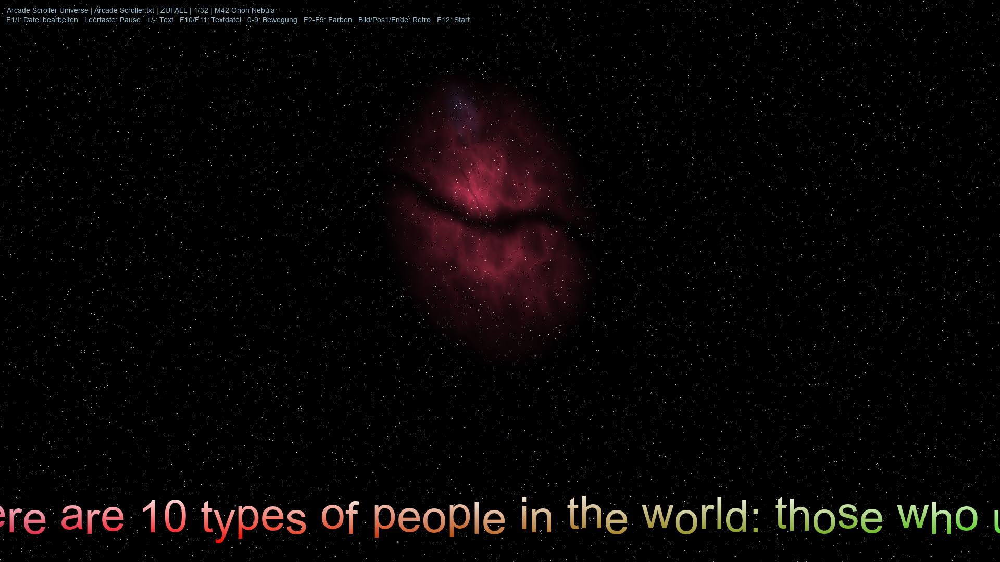

# Arcade Scroller Universe

**A retro text scroller and screensaver for Windows and Linux.** Funny and wise
sayings glide across the screen in colour gradients, over the night sky: real
nebulae, galaxies and constellations at their true places, or a galaxy drawn
anew, changing every minute or so.

**[Download Arcade Scroller Universe](https://github.com/WaveboSF/Arcade-Scroller-Universe/releases/tag/v2.0)**



| Platform | Download | Checksum |
|---|---|---|
| Windows 10/11, x64 | [Installer](https://github.com/WaveboSF/Arcade-Scroller-Universe/releases/download/v2.0/Arcade-Scroller-Universe-windows-x64-setup.exe) | [SHA-256](https://github.com/WaveboSF/Arcade-Scroller-Universe/releases/download/v2.0/Arcade-Scroller-Universe-windows-x64-setup.exe.sha256) |
| Windows 10/11, x64, portable | [ZIP](https://github.com/WaveboSF/Arcade-Scroller-Universe/releases/download/v2.0/Arcade-Scroller-Universe-windows-x86_64.zip) | [SHA-256](https://github.com/WaveboSF/Arcade-Scroller-Universe/releases/download/v2.0/Arcade-Scroller-Universe-windows-x86_64.zip.sha256) |
| Linux, x86-64, glibc 2.39+ | [Archive](https://github.com/WaveboSF/Arcade-Scroller-Universe/releases/download/v2.0/Arcade-Scroller-Universe-linux-x86_64.tar.gz) | [SHA-256](https://github.com/WaveboSF/Arcade-Scroller-Universe/releases/download/v2.0/Arcade-Scroller-Universe-linux-x86_64.tar.gz.sha256) |

A single native program with no runtime to install (no Python, no .NET).

## What it does

- **Scrolling texts** with colour gradients (F2–F9), a wave, keypad motions
  (0–9: bottom / middle / top, calm / sine wave / raster bar) and an optional
  retro look with coarser resolution and scanlines.
- **The real sky** on every second one: over 250 classic objects (all
  Messier objects, some 130 nebulae such as the Horsehead, the Heart
  and Soul, the Veil and Barnard's Loop, the jets of M87 and Centaurus A,
  the Hubble and Webb deep fields, the Magellanic Clouds …) and 22
  constellations at their true places, sizes and colours, with neighbours
  where they belong (M31 with M32 and M110, M81 with M82, the Leo Triplet,
  Stephan's Quintet) and the stick figures of the constellations.
- **A new sky every 30 to 90 seconds**: real or one of 21 galaxy types inspired by
  NASA/ESA images (spirals, barred and whirlpool galaxies, the Sombrero, ring
  and polar-ring galaxies, mergers, globular clusters, deep fields, lensing
  clusters …), with around 10,000 stars in faint true colours (warm old cores,
  blue-white young arms), fading from one to the next.
- **Subtle space sights** on about every second invented sky: a black hole
  with its lensed disk, two black holes of different mass orbiting their
  common centre of mass, a white hole fed by a red or blue supergiant, a giant
  planet passing its brown dwarf, or the little red dots of the early universe.
- **Two text files** with 48 sayings each, about computers, coffee, wisdom of
  life and taking a break, and from scientists and astronomers: `Arcade Scroller.txt` (English, also holds the
  settings) and `Arcade Scroller_1.txt` (German). Add your own as
  `Arcade Scroller_2.txt` … `_9.txt`; F10 / F11 switch between them, F1 opens
  the built-in editor for texts and settings, and saved changes appear at once.
- **Remembers** the text, mode, speed, colours and look you chose last.
- **Screensaver** on Windows (`Arcade Scroller.scr`, with preview in the
  screensaver settings) and on Linux Wayland desktops.

## Install

### Windows 10/11

Run `Arcade-Scroller-Universe-windows-x64-setup.exe`. It installs for the current
user without administrator rights into `%LOCALAPPDATA%\Programs\Arcade Scroller`,
adds a Start menu entry and can set it up as your screensaver
(with the waiting time of your choice). Uninstall it from Windows' app list; this
gives your previous screensaver back.

The installer is not code-signed, so Windows SmartScreen may warn on a download:
choose **More info**, then **Run anyway**.

Prefer no installation? Unpack the portable ZIP, start `Arcade Scroller.exe`, and
double-click `install-screensaver.cmd` to use it as the screensaver
(`uninstall-screensaver.cmd` undoes it).

### Linux

Needs x86-64 with glibc 2.39 or newer (for example Ubuntu 24.04, Fedora 40);
the SDL libraries are included.

```bash
tar -xzf Arcade-Scroller-Universe-linux-x86_64.tar.gz
cd Arcade-Scroller-Universe-linux-x86_64
./start.sh
```

As a screensaver on Wayland compositors with `ext-idle-notify-v1` (KDE Plasma,
Sway, Hyprland): `./install-screensaver.sh --minutes 5`; undo with
`./uninstall-screensaver.sh`. GNOME and X11 sessions are not supported for the
screensaver.

## Keys

The program starts in fullscreen; `--windowed` opens a window. On-screen hints
are in German for now and fade out after ten seconds.

| Key | Action |
|---|---|
| Esc / Ctrl+Q | Quit |
| Space | Pause |
| + / − (N) | Next / previous text |
| F10 / F11 | Previous / next text file |
| F1 / I | The built-in editor for texts and settings (Esc closes it) |
| 0 – 9 | Motion (like the numeric keypad) |
| F2 – F9 | File colours, six presets, random colours |
| M | Playback: single / in order / shuffled |
| Shift+M | The mouse ends the screensaver: on / off |
| Left / Right | Speed (Shift ×5) |
| Up / Down | Font size |
| Page Up / Page Down | Retro resolution coarser / finer |
| Home / End | Scanlines on / off |
| C / Shift+C | Colour change faster / slower |
| W / Shift+W, A / D | Wave height, wave frequency |
| S / B | Stars / shadow on or off |
| R | Repeat the current text (on / off) |
| F12 | Back to the file's start state |

**As a screensaver** the same keys steer it; Esc, Ctrl+Q or Ctrl+C end it, and
so do the mouse and clicks unless "Mouse ends the screensaver" is switched off
(in the editor, the setup or the text file). F1 opens the editor and ends the
screensaver, and so does switching to another window.

## Text files

Each file holds settings as `KEY=VALUE` lines (only the standard file needs
them; the others inherit them) followed by numbered text blocks:

```
@Text@1:"
There's no place like 127.0.0.1.
@Text@2:"
Rest is not idleness. — John Lubbock
```

Invalid values fall back to the defaults; the program never changes your files.

## Sky data

Everything on screen is drawn by the program itself; it contains no photographs
or other images of the sky. The real sky comes from a small catalogue of facts
(positions, sizes, brightness, names), compiled from the
[SEDS Messier Database](http://www.messier.seds.org/), SIMBAD (CDS, Strasbourg),
the [NASA/IPAC Extragalactic Database](https://ned.ipac.caltech.edu/) (NED),
[Wolfgang Steinicke's Revised NGC/IC Catalogue](https://spider.seds.org/ngc/revngcic.cgi),
the Yale Bright Star Catalogue, the IAU star names and Wikipedia; a few single
values come from the ESA/Hubble and ESO websites and other public references.
The constellation figures follow the
[IAU constellation charts](https://astro4edu.org/iau-constellation-diagrams/)
by the IAU and Sky & Telescope magazine (Roger Sinnott & Rick Fienberg),
[CC BY 4.0](https://creativecommons.org/licenses/by/4.0/), in simplified form.

The MIT License covers the program code; it claims no rights to these facts.
All sources and the credits they ask for are in [CREDITS.md](CREDITS.md).

Arcade Scroller Universe is an independent project. It is not affiliated with
or endorsed by NASA, ESA or any other organisation named here.

## Contributors

Arcade Scroller Universe is built and maintained by [S.F. / WaveboSF](https://github.com/WaveboSF),
with plenty of help from **Anthropic Claude** and [**OpenAI Codex**](https://github.com/codex).
These advanced coding tools are part of the daily toolbox—from turning ideas
into code to tracking down stubborn bugs, testing and writing the docs. The
maintainer sets the direction, decides what ships—and occasionally says,
“No, that’s not what I meant,” because otherwise we might end up in the wrong galaxy.

## License

Arcade Scroller Universe is released under the [MIT License](LICENSE). It includes SDL2,
SDL_ttf, FreeType, HarfBuzz and other libraries under their own licenses; see
[LICENSES](LICENSES/) and the `licenses` folder in each download.
