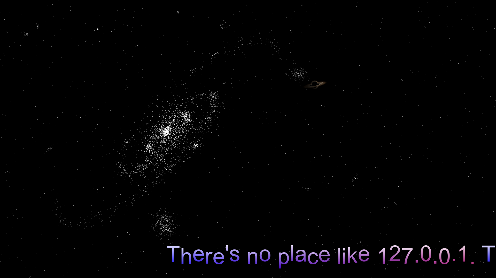

# Arcade Scroller 1.3

**A retro text scroller and screensaver for Windows and Linux.** Funny and wise
sayings glide across the screen in colour gradients, over a procedurally drawn
galaxy that changes every minute or so.

**[Download Arcade Scroller 1.3](https://github.com/WaveboSF/Arcade-Scroller/releases/tag/v1.3)**



| Platform | Download | Checksum |
|---|---|---|
| Windows 10/11, x64 | [Installer](https://github.com/WaveboSF/Arcade-Scroller/releases/download/v1.3/Arcade-Scroller-1.3-windows-x64-setup.exe) | [SHA-256](https://github.com/WaveboSF/Arcade-Scroller/releases/download/v1.3/Arcade-Scroller-1.3-windows-x64-setup.exe.sha256) |
| Windows 10/11, x64, portable | [ZIP](https://github.com/WaveboSF/Arcade-Scroller/releases/download/v1.3/Arcade-Scroller-1.3-windows-x86_64.zip) | [SHA-256](https://github.com/WaveboSF/Arcade-Scroller/releases/download/v1.3/Arcade-Scroller-1.3-windows-x86_64.zip.sha256) |
| Linux, x86-64, glibc 2.39+ | [Archive](https://github.com/WaveboSF/Arcade-Scroller/releases/download/v1.3/Arcade-Scroller-1.3-linux-x86_64.tar.gz) | [SHA-256](https://github.com/WaveboSF/Arcade-Scroller/releases/download/v1.3/Arcade-Scroller-1.3-linux-x86_64.tar.gz.sha256) |

A single native program with no runtime to install (no Python, no .NET).

## What it does

- **Scrolling texts** with colour gradients (F2–F9), a wave, keypad motions
  (0–9: bottom / middle / top, calm / sine wave / raster bar) and an optional
  retro look with coarser resolution and scanlines.
- **A new sky every 30 to 90 seconds**: one of 21 galaxy types modelled on
  NASA/ESA images (spirals, barred and whirlpool galaxies, the Sombrero, ring
  and polar-ring galaxies, mergers, globular clusters, deep fields, lensing
  clusters …), with around 10,000 stars, fading from one to the next.
- **Subtle space sights** on about every second sky: a black hole with its
  lensed disk, two black holes orbiting each other, a giant planet passing its
  brown dwarf, or the little red dots of the early universe.
- **Two text files** with 32 sayings each, about computers, coffee, wisdom of
  life and taking a break: `Arcade Scroller.txt` (English, also holds the
  settings) and `Arcade Scroller_1.txt` (German). Add your own as
  `Arcade Scroller_2.txt` … `_9.txt`; F10 / F11 switch between them, F1 opens
  the current one in your text editor and saved changes appear at once.
- **Remembers** the text, mode, speed, colours and look you chose last.
- **Screensaver** on Windows (`Arcade Scroller.scr`, with preview in the
  screensaver settings) and on Linux Wayland desktops.

## Install

### Windows 10/11

Run `Arcade-Scroller-1.3-windows-x64-setup.exe`. It installs for the current
user without administrator rights into `%LOCALAPPDATA%\Programs\Arcade Scroller`,
adds a Start menu entry and can set Arcade Scroller up as your screensaver
(with the waiting time of your choice). Uninstall it from Windows' app list; this
gives your previous screensaver back.

The installer is not code-signed, so Windows SmartScreen may warn on a download:
choose **More info**, then **Run anyway**.

Prefer no installation? Unpack the portable ZIP, start `Arcade Scroller.exe`, and
double-click `install-screensaver.cmd` to use it as the screensaver
(`uninstall-screensaver.cmd` undoes it).

### Linux

Needs x86-64 with glibc 2.39 or newer (for example Ubuntu 24.04, Fedora 40);
the SDL libraries are included.

```bash
tar -xzf Arcade-Scroller-1.3-linux-x86_64.tar.gz
cd Arcade-Scroller-1.3-linux-x86_64
./start.sh
```

As a screensaver on Wayland compositors with `ext-idle-notify-v1` (KDE Plasma,
Sway, Hyprland): `./install-screensaver.sh --minutes 5`; undo with
`./uninstall-screensaver.sh`. GNOME and X11 sessions are not supported for the
screensaver.

## Keys

The program starts in fullscreen; `--windowed` opens a window. On-screen hints
are in German for now and fade out after ten seconds.

| Key | Action |
|---|---|
| Esc / Ctrl+Q | Quit |
| Space | Pause |
| + / − (N) | Next / previous text |
| F10 / F11 | Previous / next text file |
| F1 / I | Open the current text file in the text editor |
| 0 – 9 | Motion (like the numeric keypad) |
| F2 – F9 | File colours, six presets, random colours |
| M | Playback: single / in order / shuffled |
| Left / Right | Speed (Shift ×5) |
| Up / Down | Font size |
| Page Up / Page Down | Retro resolution coarser / finer |
| Home / End | Scanlines on / off |
| C / Shift+C | Colour change faster / slower |
| W / Shift+W, A / D | Wave height, wave frequency |
| S / B | Stars / shadow on or off |
| R | Reload the file |
| F12 | Back to the file's start state |

**As a screensaver** the same keys steer it; Esc, Ctrl+Q or Ctrl+C end it,
the mouse does nothing. F1 opens the text file and ends the screensaver, and so
does switching to another window.

## Text files

Each file holds settings as `KEY=VALUE` lines (only the standard file needs
them; the others inherit them) followed by numbered text blocks:

```
@Text@1:"
There's no place like 127.0.0.1.
@Text@2:"
Rest is not idleness. — John Lubbock
```

Invalid values fall back to the defaults; the program never changes your files.

## License

Arcade Scroller is released under the [MIT License](LICENSE). It includes SDL2,
SDL_ttf, FreeType, HarfBuzz and other libraries under their own licenses; see
[LICENSES](LICENSES/) and the `licenses` folder in each download.
